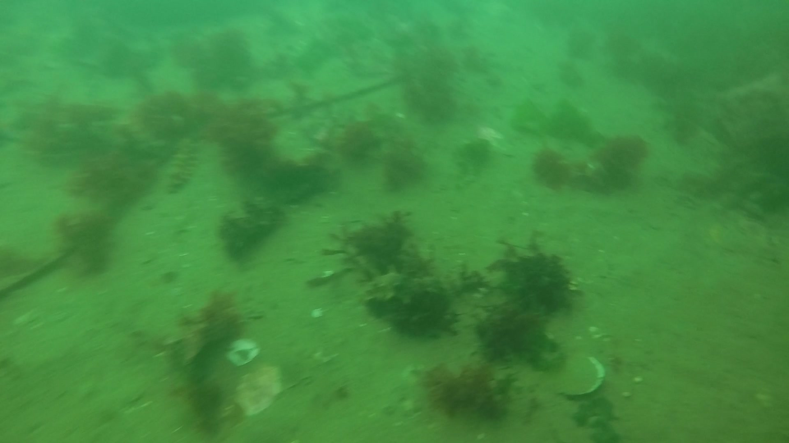
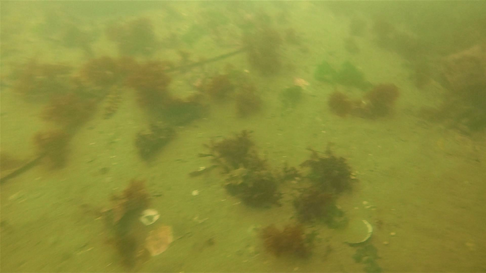

# 🌊 Underwater Image Enhancement & Object Detection Pipeline

An end-to-end automated deep learning pipeline that classifies underwater image quality, dynamically routes images to tailored enhancement models (**WaterNet** or **UWCNN**) at full native resolution, and performs object detection using a custom-trained **YOLOv8** model.

---

## 📌 Architecture Overview

The system operates in a modular 3-stage pipeline:

```text
                  ┌───────────────────────────────┐
                  │       Raw Input Image         │
                  └──────────────┬────────────────┘
                                 │
                                 ▼
                  ┌───────────────────────────────┐
                  │ Stage 1: Quality Classifier   │  (TensorFlow / EfficientNet)
                  └──────────────┬────────────────┘
                                 │
                        ┌────────┼────────┐
                        │        │        │
                        ▼        ▼        ▼
                    low_light  turbid   good
                        │        │        │
                        ▼        ▼        │
                   ┌────────┐ ┌──────┐    │
                   │WaterNet│ │UWCNN │    │ (Stage 2: PyTorch Enhancement at Native Res)
                   └────┬───┘ └──┬───┘    │
                        │        │        │
                        └────────┴───┬────┘
                                     │
                                     ▼
                  ┌───────────────────────────────┐
                  │ Stage 3: Object Detection     │  (Ultralytics YOLOv8 on URPC2020)
                  └───────────────────────────────┘
```
### 🎯 Research Objective
Underwater vision systems face severe environmental degradation due to light attenuation, scatter, turbidity, and color absorption, which significantly decrease the accuracy of object detection algorithms.

The primary objective of this project is to build an intelligent pre-processing and detection framework that:

Automatically identifies specific image degradation types (low_light, turbid, or clear good).

Dynamically applies targeted image restoration (WaterNet for exposure correction or UWCNN for color-cast dehazing) while preserving 100% native image resolution.

Feeds the restored frame into a custom YOLOv8 detector to significantly improve detection confidence for marine species (holothurian, echinus, starfish, and scallops).

###🔬 Methodology
1. **Stage 1: Quality Classification**
Architecture: Fine-tuned EfficientNet implemented in TensorFlow/Keras.

Function: Analyzes raw underwater frames and categorizes them into low_light, turbid, or good.

2. **Stage 2: Dynamic Image Enhancement**
Low-Light Routing (WaterNet): A 5-layer convolutional network optimized on the EUVP dataset to adjust exposure, lift shadow details, and increase contrast.
Turbidity Routing (UWCNN): A 10-layer dense residual architecture trained on the UWCNN dataset to correct heavy green/blue color casts, remove haze, and restore edge sharpness.
Native Resolution Inference: Executed directly on full-resolution image tensors to eliminate downsampling artifacts.
Clear Image Bypass: Images classified as good bypass enhancement to prevent unnecessary color distortion.

3. **Stage 3: Marine Object Detection**
Architecture: Custom-trained YOLOv8n trained on the reorganized URPC2020 dataset.
Target Classes: Marine organisms including holothurian (sea cucumber), echinus (sea urchin), starfish, and scallops.


### 🚀 Complete Pipeline Output (Enhancement + Object Detection)

| Stage 1: Raw Input | Stage 2: UWCNN Enhanced | Stage 3: YOLOv8 Detection Output |
| :---: | :---: | :---: |
|  |  |  |
| *Original image with heavy green turbidity* | *Restored colors and enhanced contrast at native resolution* | *Accurate detection of Holothurian (0.59) and Starfish (0.69)* |

##Key Performance Advantages:
**Resolution Preservation:** Operating at native resolution prevents fine feature blurring, helping YOLOv8 detect smaller marine targets.

**Targeted Restorations:** Routing images dynamically prevents over-processing clear frames and applies color restoration only when necessary.

**Improved Detection:** Pre-processing degraded images directly increases bounding box confidence scores and reduces false negatives compared to running detection on raw frames.

##📂 Model Weights & Download
👉 **[Click Here to Download Model Weights](https://drive.google.com/drive/folders/1Y2IkD4FCaJkq0KuUHBH9s0gs2MV8FN9D?usp=drive_link)**

###🚀 How to Run
1.**Clone the repository:**
```bash
git clone [https://github.com/YOUR_USERNAME/YOUR_REPOSITORY_NAME.git](https://github.com/YOUR_USERNAME/YOUR_REPOSITORY_NAME.git)
cd YOUR_REPOSITORY_NAME
```
2.**Install required dependencies:**
```bash
pip install -r requirements.txt
```
3.**Run the complete pipeline:**
```bash
python final_pipeline.py
```
4.**View Outputs:**
```
Enhanced images and YOLOv8 detection plots will be saved inside the output/ directory.
```
